

  <a href="https://dhiaamostafa.com">
    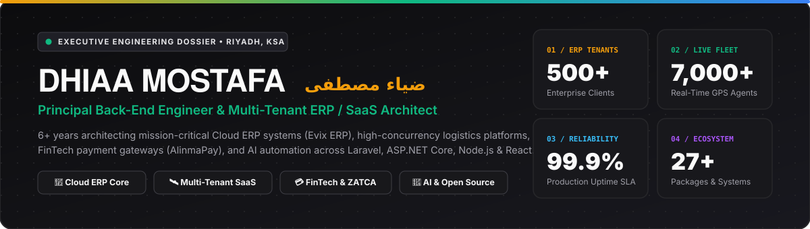
  </a>

   

  
  
  
  

 

## ⚡ Executive Engineering Profile

I am a **Senior Back-End Engineer & Enterprise Systems Architect** based in **Riyadh, Saudi Arabia**, specializing in designing fault-tolerant **Multi-Tenant SaaS platforms**, **Cloud ERP ecosystems**, **real-time logistics engines**, and **AI/FinTech integrations**.

Instead of building isolated scripts, I architect end-to-end production systems that handle **7,000+ concurrent real-time GPS agents**, synchronize financial & operational workflows across **500+ enterprise tenants**, and maintain **99.9% production uptime**.

  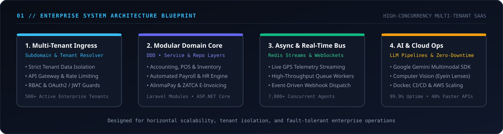

---

## 🏛️ Flagship Enterprise Systems & Case Studies

<table>
  <tr>
    <td width="50%" valign="top">
      <h3 align="left">🏢 Evix Cloud ERP — Multi-Tenant Enterprise Platform</h3>
      

        <a href="https://evix.sa">
          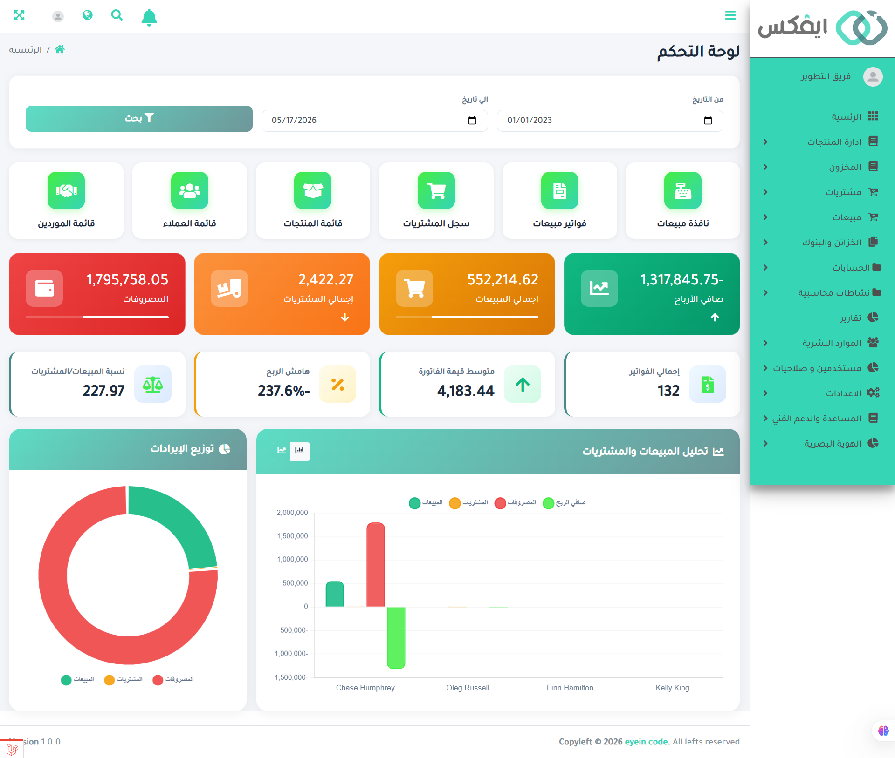
        </a>
      

      
<strong>Role:</strong> Lead Back-End & Systems Architect • <a href="https://evix.sa"><strong>Live Platform (evix.sa) ↗</strong></a>

      
Architected a full-scale multi-tenant Cloud ERP & POS platform serving <strong>500+ enterprise organizations</strong> across Saudi Arabia with strict database-per-tenant isolation.

      <ul>
        <li><strong>Core Modules:</strong> Financial Accounting, POS, Inventory, Fleet/Vehicles, HR & Payroll.</li>
        <li><strong>Multi-Tenancy:</strong> Automated tenant provisioning, sub-domain routing & isolated schemas.</li>
        <li><strong>Performance:</strong> Redis queue pipelines, modular DDD boundaries, and ZATCA e-invoicing compliance.</li>
      </ul>
      

        <code>Laravel</code> <code>ASP.NET Core</code> <code>Multi-Tenancy</code> <code>MySQL</code> <code>Redis</code> <code>Docker</code>
      

    </td>
    <td width="50%" valign="top">
      <h3 align="left">🛰️ Evix Super-Admin & Real-Time Logistics Core</h3>
      

        <a href="https://eyein.sa">
          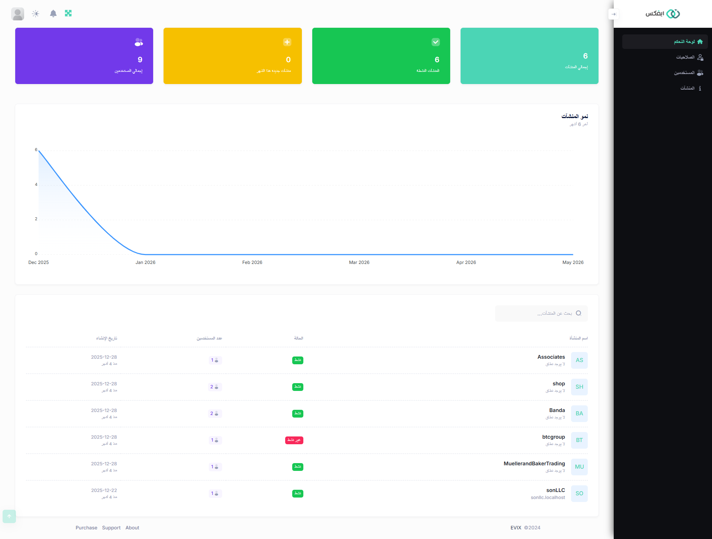
        </a>
      

      
<strong>Role:</strong> Principal Back-End Engineer • <a href="https://eyein.sa"><strong>Eyein Ecosystem (eyein.sa) ↗</strong></a>

      
Engineered the centralized tenant orchestration control plane and real-time logistics engine supporting <strong>7,000+ active delivery agents</strong> with live GPS telemetry.

      <ul>
        <li><strong>Real-Time Streaming:</strong> WebSockets & Laravel Reverb for sub-second agent tracking.</li>
        <li><strong>High Throughput:</strong> Event-driven Redis worker clusters handling peak order dispatch.</li>
        <li><strong>Security & Governance:</strong> Granular RBAC, tenant lifecycle analytics, and API Gateway guards.</li>
      </ul>
      

        <code>Node.js</code> <code>Laravel Reverb</code> <code>WebSockets</code> <code>Redis Streams</code> <code>AWS</code> <code>CI/CD</code>
      

    </td>
  </tr>
  <tr>
    <td width="50%" valign="top">
      <h3 align="left">👁️ Eyein Lenses — AI Smart Surveillance & Vision Cloud</h3>
      

        
      

      
<strong>Role:</strong> AI & Cloud Systems Architect • <a href="https://lenses.eyein.sa"><strong>Live Platform (lenses.eyein.sa) ↗</strong></a>

      
Intelligent cloud surveillance and computer-vision platform integrating real-time camera streams, automated object/facial recognition, and instant incident alerting.

      <ul>
        <li><strong>Vision Pipeline:</strong> Real-time stream ingestion with OpenCV & TensorFlow inference.</li>
        <li><strong>Enterprise Portal:</strong> Multi-branch camera monitoring, cloud recording & alert webhooks.</li>
      </ul>
      

        <code>Python</code> <code>TensorFlow</code> <code>OpenCV</code> <code>Laravel</code> <code>WebSockets</code>
      

    </td>
    <td width="50%" valign="top">
      <h3 align="left">🤖 LeadGen AI — Autonomous B2B Lead Intelligence</h3>
      

        <a href="https://github.com/dhiaamostafa46/LeadGenAI">
          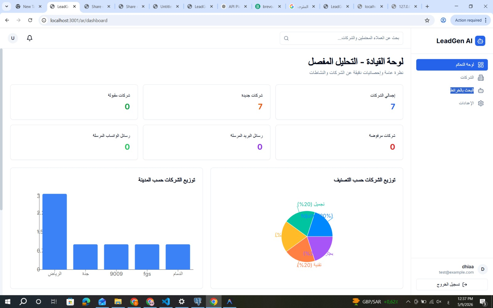
        </a>
      

      
<strong>Role:</strong> Creator & Lead Engineer • <a href="https://github.com/dhiaamostafa46/LeadGenAI"><strong>GitHub Repository ↗</strong></a>

      
AI-driven B2B lead discovery, qualification, and multi-channel outreach platform tailored for the Saudi market (Riyadh, Jeddah, Dammam) with map-based prospecting.

      <ul>
        <li><strong>Smart Discovery:</strong> Automated company extraction, sector classification & scoring.</li>
        <li><strong>Outreach Automation:</strong> Integrated WhatsApp & Email campaign pipelines with live analytics.</li>
      </ul>
      

        <code>TypeScript</code> <code>React</code> <code>Google Gemini AI</code> <code>Node.js</code> <code>REST APIs</code>
      

    </td>
  </tr>
</table>

---

## 📦 Open-Source Ecosystem, Packages & Repositories

Every link below points directly to a verified repository in my GitHub ecosystem — spanning **AI SDKs**, **FinTech Payment Integrations**, **Modular Laravel Tooling**, and **Enterprise .NET / TypeScript Applications**:

### 🧠 AI, LLMs & Intelligent Automation
| Repository | Architecture & Capabilities | Stack | Link |
| :--- | :--- | :--- | :---: |
| **`laravel-gemini`** | Multimodal Google Gemini API SDK for Laravel supporting text, vision, audio, video, structured outputs, function calling & context caching. | `PHP` `Laravel` `Gemini AI` | [View Repo ↗](https://github.com/dhiaamostafa46/laravel-gemini) |
| **`LeadGenAI`** | Full-stack AI B2B lead generation, geospatial company search, and automated WhatsApp/Email outreach analytics dashboard. | `TypeScript` `React` `AI` | [View Repo ↗](https://github.com/dhiaamostafa46/LeadGenAI) |
| **`ai-cv-optimizer`** | AI-powered resume analyzer and ATS optimization engine that restructures candidate profiles against target engineering roles. | `JavaScript` `LLM API` | [View Repo ↗](https://github.com/dhiaamostafa46/ai-cv-optimizer) |
| **`botman`** | Conversational chatbot framework & multi-driver messaging automation engine for PHP applications. | `PHP` `Chatbots` `NLP` | [View Repo ↗](https://github.com/dhiaamostafa46/botman) |

### 💳 FinTech, Security & Enterprise Platforms (.NET & PHP)
| Repository | Architecture & Capabilities | Stack | Link |
| :--- | :--- | :--- | :---: |
| **`alinma-pay`** | Enterprise banking & payment gateway integration for Alinma Bank with secure transaction signing and webhook reconciliation. | `PHP` `Laravel` `FinTech` | [View Repo ↗](https://github.com/dhiaamostafa46/alinma-pay) |
| **`authentica`** | Scalable, zero-trust identity verification and multi-factor authentication (MFA) architecture for enterprise applications. | `PHP` `Laravel` `Security` | [View Repo ↗](https://github.com/dhiaamostafa46/authentica) |
| **`AetherWallet`** | Digital wallet core supporting ledger transactions, balance isolation, and cryptographic audit trails. | `PHP` `FinTech` `Ledger` | [View Repo ↗](https://github.com/dhiaamostafa46/AetherWallet) |
| **`HRblazor`** | Enterprise Human Resources, Attendance & Payroll automation platform built on .NET & Blazor interactive components. | `C#` `.NET` `Blazor` | [View Repo ↗](https://github.com/dhiaamostafa46/HRblazor) |
| **`Real-estate`** | End-to-end property management, leasing, and real-estate brokerage platform built on C# / .NET architecture. | `C#` `ASP.NET Core` | [View Repo ↗](https://github.com/dhiaamostafa46/Real-estate) |

### ⚙️ High-Performance Laravel Packages & Real-Time Infrastructure
| Repository | Architecture & Capabilities | Stack | Link |
| :--- | :--- | :--- | :---: |
| **`reverb`** | First-party high-concurrency WebSocket server implementation for real-time Laravel broadcasting and live telemetry. | `PHP` `WebSockets` `Async` | [View Repo ↗](https://github.com/dhiaamostafa46/reverb) |
| **`laravel-modules`** | Domain-Driven Design (DDD) modular monolith manager for organizing large-scale enterprise Laravel codebases. | `PHP` `DDD` `Architecture` | [View Repo ↗](https://github.com/dhiaamostafa46/laravel-modules) |
| **`laravel-datatables`** | Server-side high-performance DataTables engine for handling millions of records with custom query builders. | `PHP` `DataTables` `SQL` | [View Repo ↗](https://github.com/dhiaamostafa46/laravel-datatables) |
| **`laravel-notification-log`** | Comprehensive audit logging and delivery telemetry for multi-channel enterprise notifications. | `PHP` `Laravel` `Observability` | [View Repo ↗](https://github.com/dhiaamostafa46/laravel-notification-log) |
| **`livewire-filepond`** | Asynchronous chunked file uploading component integrating FilePond with Laravel Livewire. | `PHP` `Livewire` `JS` | [View Repo ↗](https://github.com/dhiaamostafa46/livewire-filepond) |
| **`laravel-debugbar`** | Deep performance profiler, SQL query analyzer, and memory inspector for Laravel applications. | `PHP` `Profiling` `DevTools` | [View Repo ↗](https://github.com/dhiaamostafa46/laravel-debugbar) |
| **`browser-detect`** | Device, OS, and user-agent fingerprinting library for security auditing and adaptive rendering. | `PHP` `Security` `Analytics` | [View Repo ↗](https://github.com/dhiaamostafa46/browser-detect) |

### 🖥️ Modern Admin Dashboards & Full-Stack Web
| Repository | Architecture & Capabilities | Stack | Link |
| :--- | :--- | :--- | :---: |
| **`ReactAdmin`** | Type-safe enterprise administration dashboard with modular charts, RBAC views, and analytics widgets. | `TypeScript` `React` | [View Repo ↗](https://github.com/dhiaamostafa46/ReactAdmin) |
| **`vueDashboard`** | Reactive executive control panel and telemetry dashboard built with Vue.js. | `Vue.js` `JavaScript` | [View Repo ↗](https://github.com/dhiaamostafa46/vueDashboard) |
| **`Article`** | Modern content publishing and editorial management application with clean TypeScript architecture. | `TypeScript` `Full-Stack` | [View Repo ↗](https://github.com/dhiaamostafa46/Article) |
| **`front-end-web-ecommerce`** | High-conversion responsive e-commerce storefront with dynamic cart and catalog filtering. | `JavaScript` `UI/UX` | [View Repo ↗](https://github.com/dhiaamostafa46/front-end-web-ecommerce) |

---

## 🌐 Production Client Ecosystem (Live Platforms Delivered)

A curated visual showcase of live commercial, governmental, medical, and educational platforms architected and deployed to production:

<table>
  <tr>
    <td width="33%" align="center" valign="top">
      
       
      <strong><a href="https://eyeintec.com">Eyein Technology ↗</a></strong>
       
      Enterprise Software & Cloud Solutions (KSA)
    </td>
    <td width="33%" align="center" valign="top">
      
       
      <strong><a href="https://musanid.sa">Musanid Platform (مساند) ↗</a></strong>
       
      Digital Transformation & Business Portal
    </td>
    <td width="33%" align="center" valign="top">
      <a href="https://watantumuh.org.sa">
        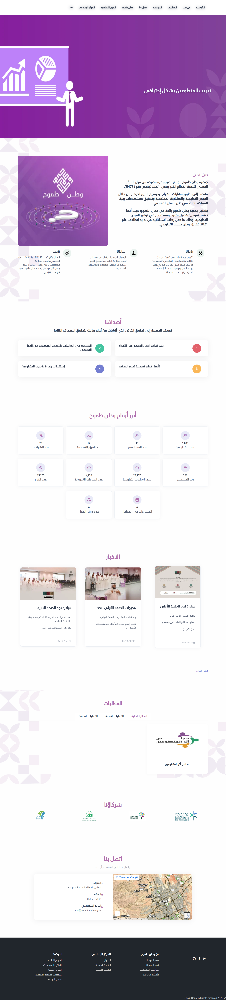
      </a>
       
      <strong><a href="https://watantumuh.org.sa">Watan Tumuh (وطن طموح) ↗</a></strong>
       
      Institutional & Non-Profit Digital Platform
    </td>
  </tr>
  <tr>
    <td width="33%" align="center" valign="top">
      <a href="https://miranedu.com">
        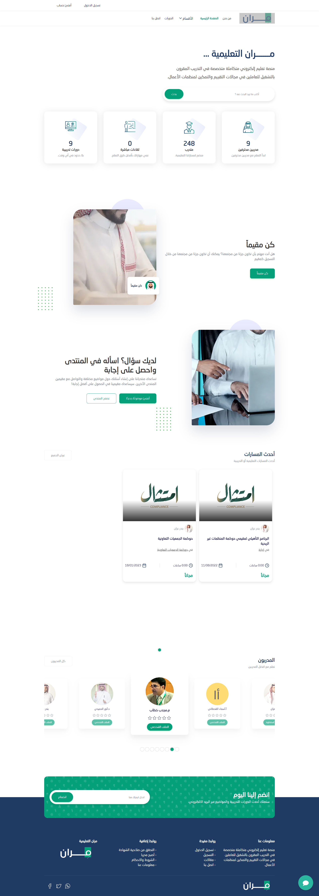
      </a>
       
      <strong><a href="https://miranedu.com">MiranEdu E-Learning ↗</a></strong>
       
      Interactive Learning Management System
    </td>
    <td width="33%" align="center" valign="top">
      
       
      <strong><a href="https://actesgroup.com">Actes Group Energy ↗</a></strong>
       
      Solar & Renewable Energy Corporate Portal
    </td>
    <td width="33%" align="center" valign="top">
      <a href="https://barmgely.com">
        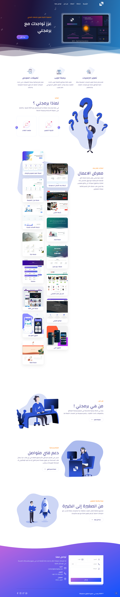
      </a>
       
      <strong><a href="https://barmgely.com">Barmgely Platform ↗</a></strong>
       
      Software Engineering & Digital Agency
    </td>
  </tr>
  <tr>
    <td width="33%" align="center" valign="top">
      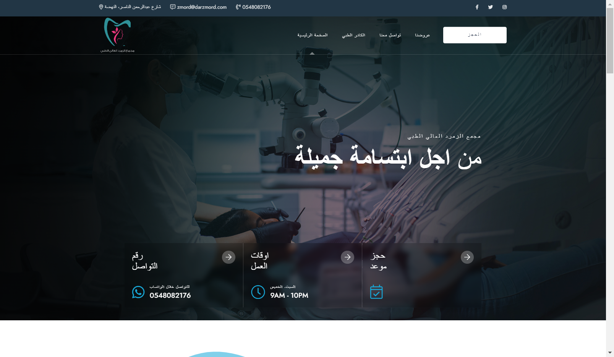
       
      <strong>Dar Al-Zomorod Medical Complex</strong>
       
      Healthcare & Clinic Booking System
    </td>
    <td width="33%" align="center" valign="top">
      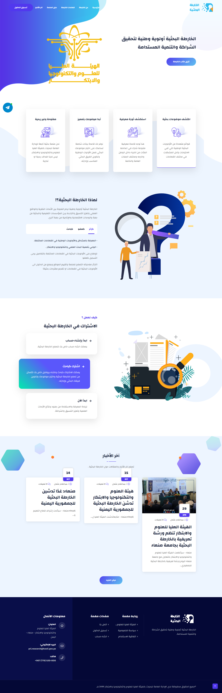
       
      <strong>National Research Priorities Portal</strong>
       
      Governmental Scientific Research Platform
    </td>
    <td width="33%" align="center" valign="top">
      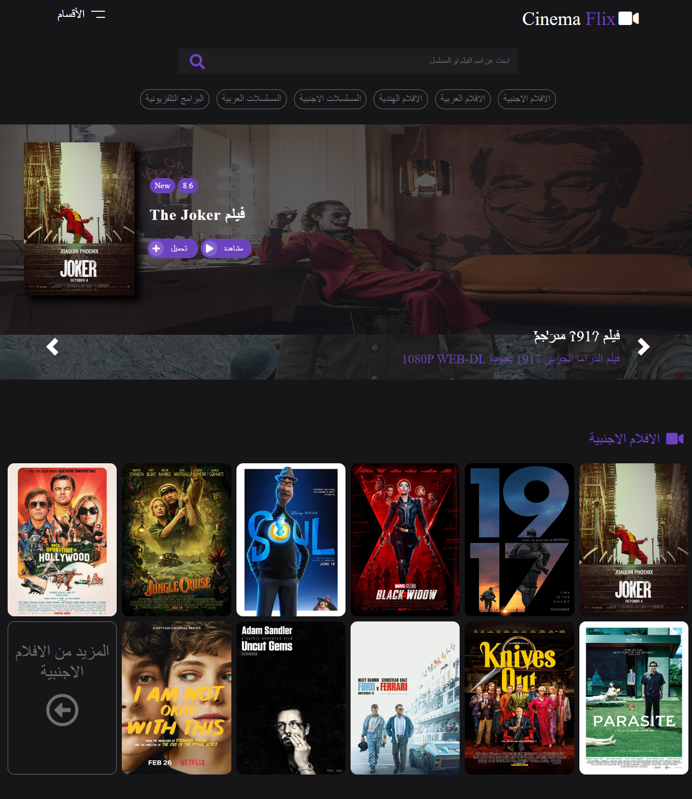
       
      <strong>Cinema Flix Media Platform</strong>
       
      Streaming & Interactive Cinema Booking
    </td>
  </tr>
</table>

---

## 🛠️ Technology & Architecture Matrix

| Domain | Primary Stack & Engineering Tooling |
| :--- | :--- |
| **Back-End & Core Languages** |       |
| **System Architecture** | `Multi-Tenant SaaS (DB-per-Tenant)` • `Modular Monolith (DDD)` • `Microservices` • `REST & GraphQL APIs` • `Event-Driven Queues` • `WebSockets (Reverb)` |
| **Data Stores & Caching** |      |
| **Front-End & Cross-Platform** |       |
| **Cloud, DevOps & AI** |      |

---

## 💼 Career Trajectory

- **🟢 Senior Software Engineer & ERP Architect — Eyein Technology (شركة عين التقنية)** *(2023 – Present | Riyadh, Saudi Arabia 🇸🇦)*
  - Architected **Evix Cloud ERP** from the ground up with multi-tenant isolation, serving **500+ enterprise clients**.
  - Engineered real-time GPS tracking and order dispatch infrastructure supporting **7,000+ active delivery agents**.
  - Led cross-functional engineering squads across ERP, HR automation, FinTech gateways, and AI surveillance (**Eyein Lenses**).
- **🟡 Full-Stack Software Engineer — SMART SYSTEM (شركة ذكاء الأنظمة)** *(2022 – 2023 | Saudi Arabia 🇸🇦)*
  - Delivered hospitality, restaurant, and enterprise resource platforms with a **95%+ on-time Agile delivery rate**.
- **🔵 Full-Stack Software Engineer — ESKYSOFT** *(2020 – 2022 | Yemen 🇾🇪)*
  - Built e-learning LMS platforms, healthcare booking portals, and e-commerce systems maintaining **99.9% uptime**.
- **🎓 B.Sc. in Information Technology** — *University of Ibb (2017 – 2021)*

---

### 🤝 Let's Architect Your Next Enterprise Platform

Available for **Principal / Senior Back-End Roles**, **Enterprise SaaS & ERP Architecture Consulting**, and **Technical Leadership**.

